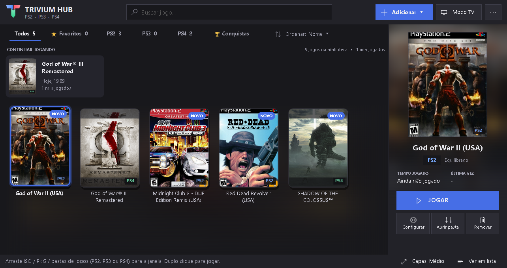
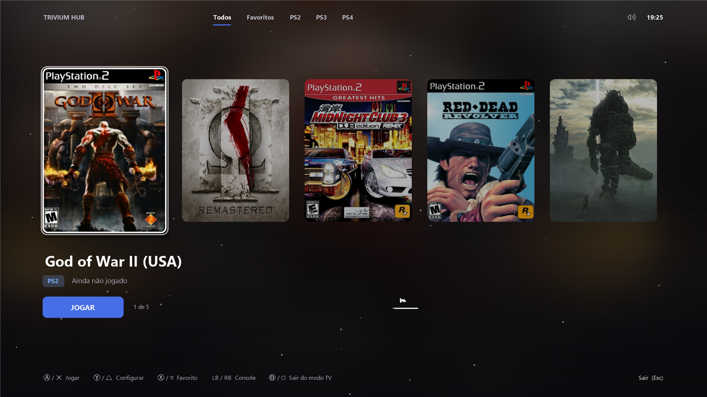
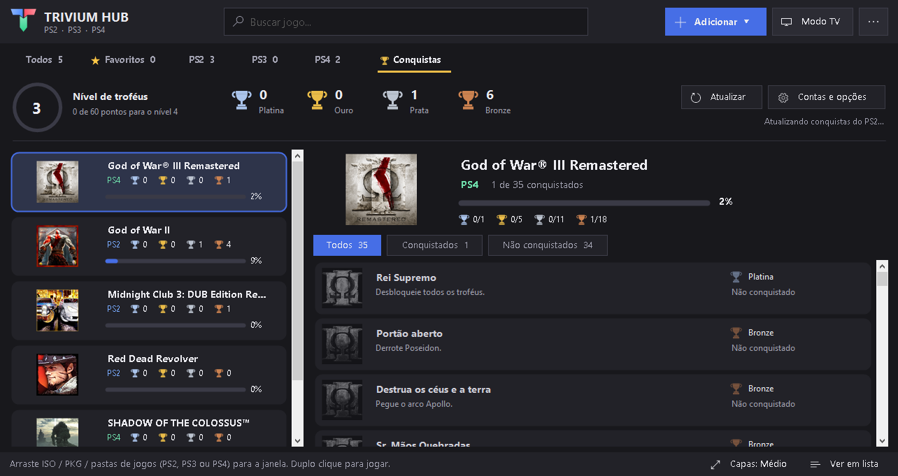
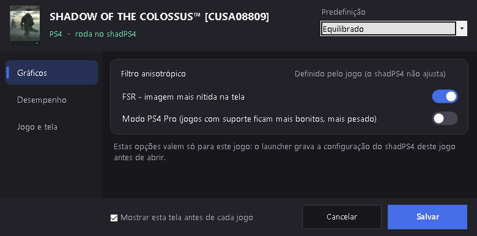

  

<h1 align="center">Trivium Hub</h1>

  Seus jogos de PS2, PS3 e PS4 em um só launcher para Windows. 
  <b>Extraia, abra e jogue.</b>

  
  
  
  

  <a href="https://github.com/snowinglikee/trivium-hub/releases/latest"><b>⬇ Baixar o Trivium Hub</b></a>
  &nbsp;·&nbsp;
  <a href="#english">English</a>

## O que ele faz

Os emuladores já vêm dentro, cada jogo abre configurado e as correções da comunidade ligam sozinhas.
Nada de baixar um emulador, um port ou um tutorial diferente para cada jogo.

- **Biblioteca** com capas, favoritos, tempo jogado e "Continuar jogando".
- **Modo TV** em tela cheia, para jogar no sofá com controle.
- **Configurações por jogo** para PCSX2, RPCS3 e shadPS4, com predefinições para PC fraco e PC forte.
- **60 FPS** em cerca de 700 jogos de PS2, com patches da comunidade.
- **God of War III Remastered e Bloodborne** com correções da comunidade prontas.
- **Conquistas** no estilo do PS5, com RetroAchievements no PS2 e troféus no PS3 e no PS4.
- **Saves** com backup automático e restauração.
- **Instalação de PKG de PS4** direto pelo launcher, com barra de progresso.
- **Português e inglês.**

| Modo TV | Conquistas |
| --- | --- |
|  |  |

| Configurações por jogo |
| --- |
|  |

## Como usar

1. Baixe o `Trivium.Hub.zip` na [página de versões](https://github.com/snowinglikee/trivium-hub/releases/latest).
2. Extraia o zip e abra o `Trivium Hub.exe`.
3. Se o Windows avisar, clique em **Mais informações** > **Executar assim mesmo**. O programa não tem
   assinatura digital paga.
4. Siga a tela **Primeiros passos** e arraste seus jogos para a janela.

O guia completo está no [LEIA-ME.txt](LEIA-ME.txt).

## Requisitos

- Windows 64 bits. Testado no Windows 10.
- PS4: processador com AVX e placa de vídeo com Vulkan 1.3.
- God of War III com as correções da comunidade: processador com AVX2.

## Não incluído

BIOS, firmware, chaves e jogos não vêm no pacote. Use apenas BIOS, firmware e jogos que você possui.

## Limitações conhecidas

- Primeira versão pública, testada principalmente em um PC.
- PS3 ainda não foi testado com jogos.
- A barra de volume não aparece por cima do shadPS4 em tela cheia, mas o volume muda normalmente.

Achou um problema? Abra uma [Issue](https://github.com/snowinglikee/trivium-hub/issues) e cole o relatório
de **... > Sobre e créditos > Diagnóstico > Copiar**.

## Código

- `app/Launcher.ps1`: o launcher (PowerShell e WinForms).
- `app/Instalar-Emuladores.ps1`: instala e atualiza os emuladores.
- `app/stub/`: código do `Trivium Hub.exe`. O `build.cmd` compila com o compilador C# do Windows.
- `app/idiomas/en.txt`: tradução para inglês.
- `app/sons/`: sons originais, gerados por `app/stub/make-sounds.ps1`.

## Licença e créditos

O código do launcher usa a licença [GNU GPL 3.0](LICENSE). Os emuladores embutidos mantêm as próprias
licenças. Licenças, créditos e links do código-fonte estão em
[app/licencas/CREDITOS.txt](app/licencas/CREDITOS.txt).

PlayStation é marca registrada da Sony Interactive Entertainment. O Trivium Hub não tem ligação com a
Sony nem com os autores dos emuladores.

## Uso de IA

Este projeto foi feito principalmente com ajuda de IA.

---

## English

Your PS2, PS3 and PS4 games in one Windows launcher. The emulators come built in, every game opens
already set up and community fixes turn on by themselves.

**[Download the latest release](https://github.com/snowinglikee/trivium-hub/releases/latest)**, extract
the zip and open `Trivium Hub.exe`. If Windows warns you, click **More info** > **Run anyway** (the program
has no paid digital signature). The full guide is in [README-EN.txt](README-EN.txt).

BIOS, firmware, keys and games are not included. Use only BIOS, firmware and games you own.

Requirements: 64-bit Windows (tested on Windows 10). PS4 needs a CPU with AVX and a graphics card with
Vulkan 1.3.

Known limits: first public release, tested mainly on one PC. PS3 has not been tested with games yet.

The launcher code is licensed under the [GNU GPL 3.0](LICENSE). This project was made mainly with AI
assistance (Claude Code).
